 

 

### 👋 Sobre mim

Desenvolvedor **full-stack com foco em front-end**, hoje na **ClickBus**, em uma plataforma multi-tenant, design system e integrações com backend.

- 🧩 Curto design systems, performance web e acessibilidade
- 🤖 IA como parceira no fluxo (Claude Code, skills e automações)
- ☁️ Convivo com Kubernetes/AWS no dia a dia

 

### 🛠️ Stack

<table>
  <tr>
    <td><b>Front-End</b></td>
    <td></td>
  </tr>
  <tr>
    <td><b>Mobile</b></td>
    <td></td>
  </tr>
  <tr>
    <td><b>Back-End</b></td>
    <td></td>
  </tr>
  <tr>
    <td><b>Infra &amp; Tools</b></td>
    <td></td>
  </tr>
</table>

 

### 📌 Projetos

<table>
  <tr>
    <td width="33%"><a href="https://github.com/Jose-iel/artflow"><b>artflow</b></a> TypeScript</td>
    <td width="33%"><a href="https://github.com/Jose-iel/insertflow"><b>insertflow</b></a> TypeScript</td>
    <td width="33%"><a href="https://github.com/Jose-iel/ceramicflow"><b>ceramicflow</b></a> TypeScript</td>
  </tr>
  <tr>
    <td><a href="https://github.com/Jose-iel/clevercashai-frontend"><b>clevercashai-frontend</b></a> TypeScript</td>
    <td><a href="https://github.com/Jose-iel/clevercashai-backend"><b>clevercashai-backend</b></a> TypeScript</td>
    <td><a href="https://github.com/Jose-iel/bot-gpt"><b>bot-gpt</b></a> TypeScript</td>
  </tr>
</table>

 

### 📊 Atividade

